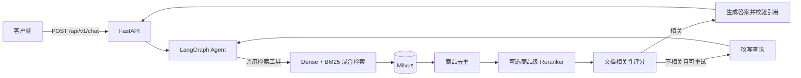

# Trusted Agentic RAG

基于 **FastAPI + LangGraph + Milvus** 的电商商品证据 RAG 后端。系统通过 Agent 判断是否需要检索，使用 Dense + BM25 混合召回商品资料，并在生成后校验引用来源、返回规范化来源元数据和检索原文。

## 当前状态

- 已导入 ShoppingComp 中文电商数据：97 条购物问题、48 条安全题、236 个商品、1190 条商品证据。
- Milvus 使用商品级证据去重、元数据过滤和可选的商品级 Rerank。
- 完整自动化测试当前为 `16 passed`，包含真实 Milvus、Embedding、Rerank 和 Agent E2E。
- 20 条抽样、Top-20 Chunk、Top-5 商品下：无 Rerank 的 Recall 为 **77.25%**，商品级 Rerank 后为 **83.17%**。
- 当前只完成了检索层评测；答案选择准确率、幻觉率和安全通过率仍需运行完整 ShoppingCompJudge。

适用场景：商品规格问答、购买需求匹配、跨商品比较、有限约束推荐和商品安全提醒。

当前示例数据不是完整的电商售后政策库；退货、退款、运费和保修等问题需要替换或扩展为对应企业的政策文档。

## 功能特性

- **Agentic RAG**：由 LangGraph 编排 Agent、检索、文档评分、查询改写和答案生成流程。
- **混合检索**：使用 Milvus 同时执行 Dense 向量检索和 BM25 稀疏检索，并通过 `RRFRanker` 融合结果。
- **商品级 Rerank**：先将 Chunk 按商品去重，再使用 Qwen Reranker 对唯一商品重排；可通过 `ENABLE_RERANK` 开关启用，异常时回退到商品级 RRF 排序。
- **Self-RAG 重试**：文档相关性评分不通过时自动改写查询；达到 `MAX_RETRIES` 后停止重试，避免无限循环。
- **引用后验校验**：检查模型返回的 `document_id` 和 `chunk_id` 是否同时存在于检索结果中，并分别返回 `verified_citations` 和 `unverified_citations`。
- **可审计来源元数据**：检索正文不包含 URL；规范化来源地址、域名和来源等级保存在独立字段中。
- **元数据过滤**：支持按来源类型、域名、来源状态、数据集、语言等允许字段过滤，不允许客户端注入原始 Milvus 表达式。
- **异步调用**：API、LangGraph 节点、Milvus 和模型客户端均使用异步接口。
- **Docker 支持**：提供 Dockerfile，可使用 `docker build` 和 `docker run` 部署 API 服务。

## 工作流程



## 技术栈

| 组件 | 技术                         |
| --- |----------------------------|
| Web API | FastAPI、Uvicorn            |
| Agent 编排 | LangGraph、LangChain        |
| 大语言模型 | DeepSeek（默认）或OpenAI兼容的模型服务 |
| Embedding | OpenAI 兼容的 Embedding API   |
| 向量数据库 | Milvus Standalone          |
| Reranker | Qwen Rerank 或兼容重排接口 |
| 依赖管理 | uv                         |
| 测试 | pytest、pytest-asyncio      |

## 目录结构

```text
.
├── src/rag/
│   ├── api/                 # FastAPI 路由与请求/响应模型
│   ├── db/                  # Milvus 客户端、集合初始化与混合检索
│   ├── graph/               # LangGraph 状态、节点与流程编排
│   ├── prompt/              # 评分、查询改写和答案生成提示词
│   ├── tools/               # Agent 检索工具与可选 Reranker
│   ├── utils/               # 文本切分等工具
│   ├── config.py            # 环境变量与客户端配置
│   └── main.py              # FastAPI 应用入口
├── tests/                   # 单测、集成/E2E 和评测脚本
├── scripts/                 # 数据转换和批量入库脚本
├── data/ecommerce/          # ShoppingComp 中文电商样例数据
├── milvus/                  # Milvus Standalone 启动脚本与本地数据卷
├── docker-compose.yml       # 一键部署配置
├── Dockerfile
├── .env.example
├── pyproject.toml
└── uv.lock
```

## 环境要求

- Python 3.12+
- [uv](https://docs.astral.sh/uv/)
- Docker Desktop 或其他可用的 Docker 环境
- Docker Compose v2
- 可访问的 Milvus 实例
- 可用的 Embedding API 和 LLM API
- 启用 Rerank 时还需要可用的 Reranker API

## 配置

首次运行前，从示例文件创建本地配置：

```powershell
Copy-Item .env.example .env
```

macOS/Linux 使用：

```bash
cp .env.example .env
```

然后编辑 `.env`，至少填写以下配置：

| 变量 | 必填 | 说明 |
| --- | --- | --- |
| `MILVUS_URI` | 是 | Milvus 地址，本地进程默认使用 `http://localhost:19530` |
| `DOCKER_MILVUS_URI` | 否 | Docker Compose 中容器访问 Milvus 的地址，默认 `http://host.docker.internal:19530` |
| `APP_PORT` | 否 | Docker 映射到宿主机的 API 端口，默认 `8000` |
| `COLLECTION_NAME` | 否 | Milvus 集合名，默认 `rag_docs` |
| `EMBEDDING_DIM` | 否 | Embedding 维度，默认 `1024`，必须与模型输出一致 |
| `EMBEDDING_BATCH_SIZE` | 否 | 批量入库时每次发送的文本数量，默认 `10`；脚本上限为 `25` |
| `EMBEDDING_API_KEY` | 是 | Embedding 服务 API Key |
| `EMBEDDING_BASE_URL` | 是 | OpenAI 兼容的 Embedding API 地址 |
| `EMBEDDING_MODEL` | 是 | Embedding 模型名称 |
| `DEEPSEEK_API_KEY` | 是 | DeepSeek API Key；也可改用 `LLM_API_KEY` |
| `LLM_API_KEY` | 否 | 通用模型 API Key，优先级高于 `DEEPSEEK_API_KEY` |
| `LLM_BASE_URL` | 否 | OpenAI 兼容模型服务地址；不填时使用 DeepSeek 默认地址 |
| `LLM_MODEL` | 否 | 模型名称，示例配置为 `deepseek-chat` |
| `MAX_RETRIES` | 否 | 最大检索重试次数；示例配置为 `2` |
| `TOP_N` | 否 | 关闭 Rerank 时保留的 Chunk 数量，默认 `3` |
| `RETRIEVAL_TOP_K` | 否 | RRF 混合检索候选数量，默认 `20` |
| `RERANK_TOP_PRODUCTS` | 否 | Rerank 后保留的唯一商品数量，默认 `5` |
| `RERANK_EVIDENCE_PER_PRODUCT` | 否 | 每个商品保留的证据数量，默认 `1` |
| `RERANK_DOC_MAX_CHARS` | 否 | 每个商品送入 Reranker 的最大字符数，默认 `4000` |
| `QUERY_MAX_CHARS` | 否 | 用户问题最大字符数，默认 `4000` |
| `CORS_ORIGINS` | 否 | 允许的前端来源，多个值用逗号分隔 |
| `ENABLE_RERANK` | 否 | 是否启用重排，设为 `true` 或 `false` |
| `RERANK_API_KEY` | 否 | 启用重排时使用的 Reranker API Key |
| `RERANK_MODEL` | 否 | 重排模型名，默认 `qwen3.7-text-rerank` |
| `RERANK_API_URL` | 否 | 完整的重排接口地址，优先级最高 |
| `RERANK_BASE_URL` | 否 | 兼容服务的 Base URL；未设置 `RERANK_API_URL` 时自动换算重排路径 |

注意事项：

- Milvus Schema 中的 `dense` 维度由 `EMBEDDING_DIM` 决定；所选 Embedding 模型必须输出相同维度。
- `.env` 包含密钥，请勿提交到 Git，也不要将其复制进镜像。
- `ENABLE_RERANK=true` 时，最终保留 `RERANK_TOP_PRODUCTS` 个唯一商品，每个商品最多保留 `RERANK_EVIDENCE_PER_PRODUCT` 条证据；此时 `TOP_N` 不再是主要截断参数。
- `ENABLE_RERANK=false` 时，系统跳过商品级重排并按 RRF 顺序保留 `TOP_N` 个 Chunk。
- `RERANK_API_URL` 是完整接口地址，优先级最高；未设置时会从 `RERANK_BASE_URL` 自动换算。
- 启用 `ENABLE_RERANK=true` 但未提供 `RERANK_API_KEY` 时，服务会回退到商品级 RRF 排序并返回降级告警。
- 生产环境应把 `CORS_ORIGINS=*` 替换为实际前端域名。

### Rerank 开关与 Top-K

当前支持两层截断，含义不同：

```text
RETRIEVAL_TOP_K
  -> 从 Milvus 召回的 Chunk 候选数

RERANK_TOP_PRODUCTS
  -> Chunk 按商品去重后，最终保留的唯一商品数
```

推荐启用商品级重排：

```env
ENABLE_RERANK=true
RETRIEVAL_TOP_K=20
RERANK_TOP_PRODUCTS=5
RERANK_EVIDENCE_PER_PRODUCT=1
```

该流程会先把同一商品的多条证据聚合，再让 Reranker 比较不同商品，以避免 Top-N 被同一商品的多个 Chunk 占满。

关闭 Rerank：

```env
ENABLE_RERANK=false
TOP_N=3
```

此时系统跳过商品级重排，直接保留 RRF 排名前 `TOP_N` 个 Chunk，可能出现同一商品重复占位。

部分 OpenAI 兼容代理不提供 `/rerank` 路径。遇到 `404` 时，应填写真实的完整 `RERANK_API_URL`，而不是只填聊天接口的 `RERANK_BASE_URL`。

## 快速开始

### 1. 安装依赖

在项目根目录执行：

```powershell
uv sync --dev
```

### 2. 启动 Milvus

仓库附带了 Windows Milvus Standalone 启动脚本。脚本使用当前目录挂载配置和数据卷，因此必须先进入 `milvus` 目录：

```powershell
cd milvus
.\standalone.bat start
cd ..
```

确认 Milvus 已就绪：

```powershell
docker ps --filter "name=milvus-standalone"
docker logs milvus-standalone
```

停止 Milvus：

```powershell
cd milvus
.\standalone.bat stop
cd ..
```

如已有其他 Milvus 实例，可跳过此步骤，并修改 `.env` 中的 `MILVUS_URI`。

### 3. 准备电商数据

仓库包含 ShoppingComp 中文电商样例的转换脚本，使用 MIT 许可证。数据包含 97 条购物需求、48 条安全题、236 个商品和 1190 条商品证据。

```powershell
uv run python scripts\prepare_shoppingcomp.py
```

转换后的检索正文不包含 URL。来源地址会经过协议校验、去重、移除跟踪参数和域名分类，保存在 `source_urls`、`source_url`、`source_domain`、`source_type` 和 `source_status` 中。没有来源地址的文档会标记为 `source_status=missing`；`provided` 只表示来源已提供，不代表已经完成在线可用性验证。

生成文件：

- `data/ecommerce/shoppingcomp/documents.jsonl`
- `data/ecommerce/shoppingcomp/questions.jsonl`
- `data/ecommerce/shoppingcomp/questions_sample.jsonl`
- `data/ecommerce/shoppingcomp/safety_questions.jsonl`

`documents.jsonl` 用于知识库入库；`questions.jsonl` 和 `safety_questions.jsonl` 用于评测，不应加入检索知识库，以免问题或标准答案泄漏给模型。

数据来自 [ShoppingComp](https://hf-mirror.com/datasets/huaixiao/ShoppingComp)，使用 MIT 许可证。97 条问题中 42 条来自专家、55 条为合成用户需求；商品证据带有外部来源，但不代表所有链接都已在线核验。来源、引用和许可说明见 `data/ecommerce/shoppingcomp/NOTICE.md`。

### 4. 重建集合并入库

先做离线校验，不调用部署模型：

```powershell
uv run python scripts\ingest_shoppingcomp.py --dry-run
```

确认 `.env` 中的 Embedding 配置可用后，全量重建集合并导入：

```powershell
uv run python scripts\ingest_shoppingcomp.py --recreate
```

> **警告：** `--recreate` 会先删除同名集合及其中已有数据。该参数用于 Schema 升级或全量覆盖，不要在不清楚集合内容时使用。

如果集合已经使用相同 Schema，可省略 `--recreate`，通过主键执行幂等 upsert：

```powershell
uv run python scripts\ingest_shoppingcomp.py
```

仅初始化空集合：

```powershell
uv run python -m rag.db.init_collection
```

`sparse` 字段由 Milvus 的 BM25 Function 根据清洗后的 `text` 自动生成，不需要由入库脚本提供。

### 5. 启动 API

```powershell
uv run uvicorn rag.main:app --host 0.0.0.0 --port 8000 --reload
```

启动后可访问：

- Swagger UI：<http://localhost:8000/docs>
- ReDoc：<http://localhost:8000/redoc>
- OpenAPI JSON：<http://localhost:8000/openapi.json>
- 健康检查：<http://localhost:8000/api/v1/health>

健康检查会确认 Milvus 集合存在且包含数据；集合未就绪时返回 `503`。

## Docker 部署

以下命令均在项目根目录执行。Dockerfile 会先安装锁定依赖，再以非 root 用户运行应用；`.env`、测试和本地配置不会被打包进镜像，而是在运行容器时注入。镜像健康检查会请求 `/api/v1/health`，并确认 Milvus 集合已经就绪。

### 一键部署

Windows PowerShell：

```powershell
Set-ExecutionPolicy -Scope Process Bypass
.\scripts\docker-deploy.ps1
```

Linux/macOS：

```bash
chmod +x scripts/docker-deploy.sh scripts/docker-stop.sh
./scripts/docker-deploy.sh
```

脚本会自动：

1. 检查 Docker、Docker Compose 和 `.env`。
2. 构建最新 `rag-agentic-api:latest` 镜像。
3. 删除旧的 `rag-container`，避免继续运行旧镜像。
4. 使用 [docker-compose.yml](docker-compose.yml) 重新创建容器。
5. 等待 `/api/v1/health` 返回 healthy。

可选参数：

```powershell
# 不重新构建，仅使用已有镜像重新创建容器
.\scripts\docker-deploy.ps1 -NoBuild

# 启动后立即返回，不等待健康检查
.\scripts\docker-deploy.ps1 -NoWait
```

停止并删除应用容器：

```powershell
.\scripts\docker-stop.ps1
```

Linux/macOS 停止脚本：

```bash
./scripts/docker-stop.sh
```

一键脚本不会删除镜像、Milvus 容器或 Milvus 数据。

### 手动部署

如果不想使用 Docker Compose，也可以手动执行以下步骤。

#### 1. 构建镜像

```powershell
docker build -t rag-agentic-api .
```

#### 2. 启动应用容器

Milvus 运行在宿主机时，应用容器内的 `localhost` 指向容器自身。因此需要：

1. 通过 `--add-host=host.docker.internal:host-gateway` 将宿主机映射为 `host.docker.internal`。
2. 使用 `-e MILVUS_URI=http://host.docker.internal:19530` 覆盖 `.env` 中的本地地址。

PowerShell 命令：

```powershell
docker run -d `
  --name rag-container `
  --restart unless-stopped `
  -p 8000:8000 `
  --add-host=host.docker.internal:host-gateway `
  --env-file .env `
  -e MILVUS_URI=http://host.docker.internal:19530 `
  rag-agentic-api
```

Bash/Zsh 命令：

```bash
docker run -d \
  --name rag-container \
  --restart unless-stopped \
  -p 8000:8000 \
  --add-host=host.docker.internal:host-gateway \
  --env-file .env \
  -e MILVUS_URI=http://host.docker.internal:19530 \
  rag-agentic-api
```

如果 Milvus 是同一 Docker 网络中的另一个容器，也可以创建并使用自定义网络，随后把 `MILVUS_URI` 改为 Milvus 的容器名，例如 `http://milvus-standalone:19530`。

#### 3. 检查运行状态

```powershell
docker ps --filter "name=rag-container"
docker logs -f rag-container
```

打开 <http://localhost:8000/docs> 验证 API 文档是否可访问。

#### 4. 停止和删除应用容器

```powershell
docker stop rag-container
docker rm rag-container
```

修改代码或环境变量后，需要重新构建镜像并重新创建容器：

```powershell
docker stop rag-container
docker rm rag-container
docker build -t rag-agentic-api .
```

完成后再次执行上面的 `docker run` 命令。

## API 使用

### 请求

```http
POST /api/v1/chat
Content-Type: application/json
```

请求体：

```json
{
  "query": "我想买一台适合旅行拍摄的相机，需要4K视频和动物眼部对焦",
  "filters": {
    "source_type": "official",
    "source_status": "provided",
    "language": "zh"
  }
}
```

`filters` 可省略。可用字段包括 `source_type`、`source_domain`、`source_status`、`task_id`、`document_type`、`dataset` 和 `language`。

PowerShell 调用示例：

```powershell
$body = @{
    query = "我想买一台适合旅行拍摄的相机，需要4K视频和动物眼部对焦"
    filters = @{
        source_type = "official"
        source_status = "provided"
        language = "zh"
    }
} | ConvertTo-Json -Depth 5

Invoke-RestMethod `
  -Method Post `
  -Uri "http://localhost:8000/api/v1/chat" `
  -ContentType "application/json" `
  -Body $body
```

curl 调用示例：

```bash
curl -X POST "http://localhost:8000/api/v1/chat" \
  -H "Content-Type: application/json" \
  -d '{"query":"我想买一台适合旅行拍摄的相机","filters":{"source_status":"provided"}}'
```

### 单问题诊断脚本

不启动 Web 服务也可以直接执行完整问答：

```powershell
uv run python tests\ask_single_question.py "索尼α6700是否支持4K视频？" --filter source_type=official
```

脚本会打印答案、检索数量、引用 ID、来源 URL、证据片段、告警和未验证引用。可选参数：

```text
--url http://localhost:8000  # 改为请求已经运行的服务
--json                       # 输出原始 JSON
--full-evidence              # 显示完整引用证据
--filter KEY=VALUE           # 可重复传入元数据过滤条件
```

### 响应

```json
{
  "request_id": "bf2cda0346f74ba4a62359187f5c69bb",
  "answer": "根据知识库内容生成的回答。",
  "verified_citations": [
    {
      "document_id": "shoppingcomp:任务ID:0",
      "chunk_id": "shoppingcomp:任务ID:0:场景ID",
      "title": "索尼α6700",
      "source_url": "https://www.sony.com/...",
      "source_urls": [
        "https://www.sony.com/...",
        "https://www.rtings.com/..."
      ],
      "source_domain": "sony.com",
      "source_type": "official",
      "source_status": "provided",
      "evidence": "商品：索尼α6700\n\n商品证据：支持4K视频……"
    }
  ],
  "unverified_citations": [],
  "retrieval_count": 5,
  "is_degraded": false,
  "alerts": []
}
```

字段说明：

| 字段 | 说明 |
| --- | --- |
| `request_id` | 请求追踪 ID，同时写入响应头 `X-Request-ID` |
| `answer` | 最终答案 |
| `verified_citations` | 文档 ID 和块 ID 同时匹配检索结果的引用，并附带来源元数据和检索原文 |
| `unverified_citations` | 未通过后验校验的模型引用 |
| `retrieval_count` | 本次请求最终保留的去重证据数量 |
| `is_degraded` | 是否发生降级、来源缺失或输出异常 |
| `alerts` | 重排、检索、来源或输出格式相关告警 |

说明：

- `retrieval_count` 表示本次实际提供给 Agent 的去重商品证据数。
- `verified_citations` 只包含模型最终实际引用的来源，因此数量可能小于 `retrieval_count`。
- `source_url` 是首选来源，`source_urls` 保存该证据块关联的全部规范化 URL；`source_url` 不保证逐条支持答案中的所有结论。
- `verified_citations` 只证明引用 ID 来自本次检索结果，不证明答案中的每项陈述都已被引用原文蕴含。
- 参数校验失败返回 `422`；Agent 内部异常返回 `500` 和 `request_id`；集合未就绪时健康检查返回 `503`。

## 测试

离线数据与 API Schema 测试：

```powershell
uv run pytest -q tests\test_data_pipeline.py
```

完整测试：

```powershell
uv run pytest -q
```

当前完整套件结果为 `16 passed`。`tests/test_search.py` 和 `tests/test_agent_flow.py` 依赖真实的 Milvus 数据以及外部 Embedding/LLM/Reranker 服务，需要先完成入库和 `.env` 配置。

测试覆盖：

- `tests/test_data_pipeline.py`：URL 清洗、过滤表达式、数据完整性和 OpenAPI 字段。
- `tests/test_reranker.py`：商品聚合、商品级去重、重排地址推导和失败回退。
- `tests/test_citation_pipeline.py`：检索节点、引用校验、API 返回和 LangGraph 状态。
- `tests/test_search.py`：验证 Milvus 混合检索能召回预期商品。
- `tests/test_agent_flow.py`：执行从用户问题到最终答案的 Agent E2E 流程。

完成入库后可对比 Chunk 候选、商品级去重和 Rerank 的效果：

```powershell
uv run python tests\evaluate_retrieval.py --top-k 20 --top-products 5 --limit 20
```

报告默认同时运行 `no-rerank` 和 `rerank`，包含候选商品命中率、精排后商品 Precision/Recall/F1、MRR 以及 Rerank 告警数。该脚本需要真实 Embedding、Reranker 服务和已入库的 Milvus 集合；报告写入 `data/ecommerce/shoppingcomp/evaluation/retrieval_report.json`。

只运行一种模式：

```powershell
uv run python tests\evaluate_retrieval.py --mode no-rerank
uv run python tests\evaluate_retrieval.py --mode rerank
```

当前 20 条抽样、Top-20 Chunk、最终 Top-5 商品的对比结果：

| 模式 | HitRate | Precision | Recall | F1 | MRR |
| --- | ---: | ---: | ---: | ---: | ---: |
| 商品去重，无 Rerank | 90.00% | 35.00% | 77.25% | 43.26% | 69.58% |
| 商品级 Rerank | **90.00%** | **40.00%** | **83.17%** | **48.62%** | **90.00%** |

必须保持候选数量、最终商品数量和评测问题完全一致，才能比较 Rerank 前后指标。

评测解释：

- 这组指标衡量的是商品检索，不是最终答案准确率或幻觉率。
- 当前测试集每题平均只有 2.6 个标准商品，但系统固定返回 5 个，因此 Precision@5 会因“补足名额”而下降。
- 同一报告中的 Rerank Top-1 Precision 为 90%，Top-2 Precision 为 70%、F1 为 64.05%；若优先推荐质量，可测试 `--top-products 2`。
- 要得到完整结论，还需要在 97 条购物题和 48 条安全题上运行 ShoppingCompJudge，评测 SoP、Scenario Coverage、Rationale Validity 和 Safety Pass Rate。

查看集合中的已有数据：

```powershell
uv run python tests/check_db.py
```

## 常见问题

### 容器返回 Milvus 连接失败

本地运行时使用 `http://localhost:19530`；应用容器运行时应使用 `http://host.docker.internal:19530`，并确保宿主机已暴露 Milvus 的 `19530` 端口。

### 集合不存在

执行 `uv run python -m rag.db.init_collection` 创建空集合；只有增加 `--recreate` 才会删除并重建已有集合。

### Embedding 维度不匹配

修改 `.env` 中的 `EMBEDDING_DIM`，使其与模型输出一致，然后重新执行 `scripts/ingest_shoppingcomp.py --recreate` 重建集合并入库。

### 检索结果为空

确认 `.env` 中的 `COLLECTION_NAME` 指向已写入数据的集合，并检查 `document_id`、`chunk_id`、Embedding 模型和过滤条件是否一致。

### 返回 `is_degraded=true`

检查 `alerts` 内容。如果已设置 `ENABLE_RERANK=true`，还需要设置有效的 `RERANK_API_KEY` 和正确的 `RERANK_API_URL`；缺少 Key、接口失败或返回格式异常时，系统会回退到商品级 RRF 排序。

### Rerank 返回 404

聊天接口的 `RERANK_BASE_URL` 不一定提供重排接口。请确认服务商的实际 Rerank 路径，并设置完整的 `RERANK_API_URL`。代码支持从常见的 `/v1` 或 `/compatible-mode/v1` Base URL 推导路径，但服务商自定义路径仍应显式配置。

### 修改 `TOP_N` 后商品数量没变化

当 `ENABLE_RERANK=true` 时，最终商品数量由 `RERANK_TOP_PRODUCTS` 控制；`TOP_N` 主要用于关闭 Rerank 时的 Chunk 截断。修改后需要重启 API 进程，正在运行的容器也需要重新创建。

### `source_url` 与回答中的具体结论不匹配

`source_url` 表示该证据块的首选来源，`source_urls` 才是全部来源。当前检索单元可能包含多个事实和多个来源，展示端应同时提供 `source_urls`，并在生产环境中进一步做到“单条结论对应来源”。
